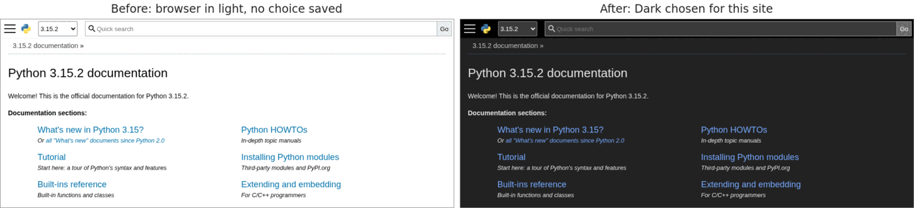

# Per-Site Light/Dark Mode

Makes a site show its own light or dark theme, whatever your browser is set to,
and remembers your choice for that site. It switches to the theme the site
already has. It never generates or inverts colors, so it is not a dark mode for
sites that don't have one.

It helps on sites that have both a light and a dark theme and follow your
browser's setting. Tested on react.dev, developer.mozilla.org, github.com,
docs.python.org, w3.org and wiki.archlinux.org.

## How to use

Before you start, you need a [userscript manager][manager], either Violentmonkey
or Tampermonkey. On Chrome and other Chromium browsers, also turn on the **Allow
User Scripts** switch for the manager: open `chrome://extensions`, select
**Details** on the manager, and turn on **Allow User Scripts**. Without it, no
userscript runs.

1. Open a site that has both a light and a dark theme. If the site has its own
   theme button, set it to System or Automatic first. A theme you pick with the
   site's own button wins over this script.
2. Open your userscript manager's menu for the page.
3. Under Per-Site Light/Dark Mode, select the **Dark for** entry. It ends with
   the site's name and "(reloads the tab)". For example, on Python's
   documentation it reads **Dark for docs.python.org (reloads the tab)**. For
   the light theme, select the **Light for** entry instead.
4. Wait for the tab to reload. The site now shows the theme you selected.
5. If nothing changed, open the menu again and select **Status**. It tells you
   in plain words whether your choice applied and what to try next.

To undo a choice, select the **Browser default for** entry. The site then
follows your browser again.

## Settings

There is no settings page. The menu is the only control, and it saves one choice
per site:

- Light: the site shows its light theme.
- Dark: the site shows its dark theme.
- Browser default: the script does nothing on that site.

The menu marks your current choice with a check mark, and it names the site the
choice is saved for.

A choice also covers the site's subdomains. If you select Dark on `example.com`,
then `www.example.com` and `docs.example.com` use Dark too. To give one
subdomain a different theme, open that subdomain and select again. A choice
saved on a subdomain wins over the one from its parent. Browser default on a
subdomain makes it ignore the parent's choice.

A choice always saves on the site you are on, never on its parent. The one
exception is a leading `www.`: a choice on `www.example.com` saves on
`example.com`, so `docs.example.com` uses it too. IP addresses match only
themselves.

## Where it runs and what it can access

The script runs on every `http` and `https` page, because you can pick any site.
On a site where you have not made a choice, it does nothing.

It asks your userscript manager for these permissions:

- `unsafeWindow`: to reach the page's own scripts. This is how the script
  answers the page when it asks whether you prefer a light or dark theme.
- `GM_getValue`, `GM_setValue` and `GM_deleteValue`: to read, save and remove
  your choices in the manager's storage.
- `GM_registerMenuCommand`: to add the entries to your manager's menu.

It reads the page's style sheets so it can switch their light and dark rules. It
does not read your forms, cookies or the text of the page, and it makes no
network requests.

## Limitations

- It only changes sites that have a dark theme of their own. On a site with just
  one theme, nothing changes.
- It can't read some style sheets that a site loads from another web address
  without allowing access. Parts of the page that depend on them may not switch.
  **Status** may mention them.
- A page that checks your theme very early, before the script runs, may keep
  your browser's setting. **Status** may say so. Reloading the page or setting
  the site's own theme to System or Automatic may help.
- A site that saves your theme with your account, or in its own button, decides
  for itself. The script does not override it.
- It can't reach parts of some pages built as sealed components before it
  runs. Those parts may not switch.
- It does not run inside frames, so embedded content, such as a video player,
  is left alone.
- You may see the other theme for a moment before the page switches.
- On pages that are not HTML, your manager can't run the script inside the page
  itself, so the page's own scripts may still see your browser's setting.
  **Status** says so. In Firefox, a site with a strict Content Security Policy
  may cause the same problem. **Status** should say so there too.
- It works in Violentmonkey and Tampermonkey. It does not work in Greasemonkey 4
  or in Safari's Userscripts.

## Privacy

- Stores one choice per site (light, dark or browser default) in your userscript
  manager's storage on your device.
- Makes no network requests. It collects no analytics and shares nothing.
- The site you are on can see which theme it was told you prefer, as it can with
  your browser's setting. It can't see your choices for other sites.
- If your manager syncs or backs up its data, your choices go with it. That is
  the manager's feature, not this script's.

See [PRIVACY.md][privacy] for the same information about every script in this
collection.

## Changelog and support

- [Changelog][changelog]
- [Report a bug or ask for a feature][issues]

[manager]: https://github.com/yyyyyyyan/userscripts#get-a-userscript-manager
[privacy]: https://github.com/yyyyyyyan/userscripts/blob/main/PRIVACY.md
[changelog]: https://github.com/yyyyyyyan/userscripts/blob/main/scripts/per-site-light-dark-mode/CHANGELOG.md
[issues]: https://github.com/yyyyyyyan/userscripts/issues
