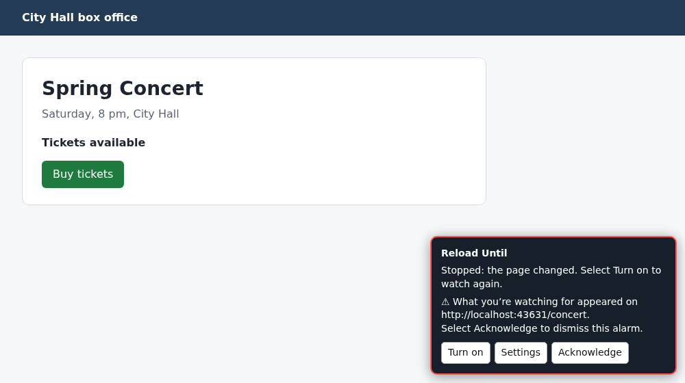

# Reload Until

Reloads a page while you wait for tickets, a restock or an appointment slot,
and raises an alarm when something you pick appears or disappears. The alarm
stays on the page until you acknowledge it, and it also goes off if the site
sends a reload to a different page, such as a sign-in page after your session
expires.

## What you need

- A [userscript manager][manager], either Violentmonkey or Tampermonkey.
- On Chrome and other Chromium browsers, the manager's **Allow User Scripts**
  switch turned on. Open `chrome://extensions`, select **Details** on the
  manager, and turn on **Allow User Scripts**. Without it, no userscript runs.
- A page that shows something you can wait for, such as a "Sold out" label that
  goes away or a "Buy tickets" button that shows up.

After you install the script, the first page you open shows a tip about where
the settings are. The tip shows only once.

## How to use

### Find the part of the page to watch

The script needs to know which part of the page to check. The simplest choice
is `body`, the whole page, together with the words to look for. To check one
part of the page instead, you need its CSS selector:

1. Right-click the part of the page that will change, and select **Inspect**.
2. In the developer tools, right-click the highlighted line.
3. In Chrome, select **Copy** > **Copy selector**. In Firefox, select **Copy** >
   **CSS Selector**.

### Watch a page

1. Open the page you want to watch.
2. Open your userscript manager's menu.
3. Select **Reload Until settings**. The settings panel opens with the page's
   address already filled in.
4. In **Element to look for**, enter `body` or the selector you copied.
5. If you are waiting for particular words, enter them in
   **Containing text (optional)**, for example `Tickets available`.
6. In **Raise the alarm when the element**, select **Appears** or
   **Disappears**.
7. If you selected **Disappears**, enter something that is always on the real
   page, such as its main heading, in
   **Only check when the page has this element (optional)**. Error pages and
   sign-in pages make things disappear too. With this check, such a page raises
   an alarm that says the page may be an error or sign-in page, instead of a
   false alarm that what you're watching for disappeared.
8. Select **Save watch**.
9. Leave the tab open.

A box named **Reload Until** appears in the lower right corner of the page and
says what the watch is doing. The tab title shows `👁 WATCHING` and counts down
to the next reload.

### Check how an alarm reaches you

Before you rely on a watch, select **Test alert** in the box. It shows a test
alarm the way your watch's alert style would, including any desktop
notification and sound. Your watch keeps running, so the next reload clears
the test. Select **Acknowledge** to dismiss it sooner.

### When the alarm goes off

The page stops reloading. The box turns red and says what happened, and the tab
title starts with `⚠ ACKNOWLEDGE`. Depending on the alert style, you also get a
desktop notification and a sound. Selecting the notification may bring you to
the tab, depending on your browser and userscript manager.

1. Go to the tab and look at the page.
2. Select **Acknowledge** in the box.

The watch is now off. To watch again, select **Turn on** in the box, or turn on
**Watch this page** in the settings.

If the page doesn't have the element you entered in
**Only check when the page has this element (optional)**, the alarm says the
page may be an error or sign-in page, and the watch pauses. Check the page and
sign in again if you need to. Then select **Acknowledge**, and select
**Resume**.

If a reload ended on a different page, the box on that page says so and offers
**Open watched page**. Sign in again if you need to, then select
**Open watched page**. The alarm waits on the watched page too, until you
acknowledge it.

### Pause, change or delete a watch

- To stop reloading, select **Turn off** in the box. Until the page next loads,
  the box offers **Turn on**. After that, a watch that is off shows nothing on
  its page, and you turn it on again in the settings.
- To fold the box down to its name, select **Hide**. Select **Show** to open it
  again. An alarm always opens it.
- To change a watch, open the settings on any page of the same site, select the
  watch in **Saved watches**, make your changes, and select **Save watch**.
- To delete a watch, select it in **Saved watches**, then select
  **Delete watch**.

While an alarm is waiting, you can't change or delete its watch. Acknowledge
the alarm first.

## Settings

The settings panel lists only the watches for the site you are on, under
**Saved watches**. While it is open, the tab doesn't reload. It warns you before
it throws away changes you haven't saved, and Escape closes it.

### What to watch

- **Page address**: the exact address to reload. It must be on the site you are
  on. Anything after `#` is ignored, but the rest counts, so a page with
  `?page=2` at the end needs its own watch. Each address has one watch.
- **Element to look for**: the CSS selector you copied, or `body` for the whole
  page.
- **Containing text (optional)**: the element counts only if its text contains
  these words. Extra spaces and line breaks don't matter. Only text the page
  shows counts: hidden parts of the page and its scripts are ignored.
- **Match case**: treat capital and small letters in the text as different.
  It's off by default.
- **Raise the alarm when the element**: **Appears** (the default) or
  **Disappears**.
- **Only check when the page has this element (optional)**: a selector for
  something that is always on the real page. If the page doesn't have it, the
  alarm goes off and says the page may not be the real one, and the watch
  pauses until you select **Resume**. The panel asks for this when you select
  **Disappears**.

### When

- **Watch this page**: on for a new watch. While it is on, the page reloads
  whenever it is open in a tab, until the alarm goes off.
- **Seconds between reloads**: how often the page reloads, counted from when it
  loads. 30 by default, and at least 10.
- **Seconds to wait after the page loads**: gives the page time to show its
  content before the first check. 5 by default.
- **Seconds the change must last**: the alarm goes off only if the change is
  still there after this long, so a brief flicker doesn't set it off. 3 by
  default. The page doesn't reload while a change is being checked.

### How to alert

**Alert style** sets how an alarm reaches you. Every style keeps the alarm on
the page and in the tab title until you select **Acknowledge**.

- **On this page only**: no desktop notification and no sound.
- **On this page, plus one desktop notification**: the default.
- **On this page, plus a desktop notification and a sound every minute**: the
  notification and a short alert sound repeat every minute until you
  acknowledge the alarm, as long as the tab stays open.

Each time a page with a waiting alarm loads, it sends the desktop notification
again, for example when you reload it.

**Allow desktop notifications** asks your browser to let the site show its own
notifications:

- Once you allow them, alarms use them and ask the browser to keep them on
  screen until you select or close them.
- Until then, alarms use your userscript manager's notifications, which some
  browsers hide after a few seconds.

The line above the button says which one the site uses. Each site has its own
permission, so allow notifications on every site you watch. Sites whose address
starts with `http://` usually can't show their own notifications.

## Where it runs and what it can access

The script runs on every `http` and `https` page, because you can watch any page
and a reload can end on another site. It doesn't run inside frames.

On a page without a watch, it adds its entry to your userscript manager's menu.
It checks whether the page has a watch and whether an alarm is waiting in the
tab. After a reload, it also checks whether a watched page's reload ended there.
It does nothing else on that page, apart from the one-time tip after you install
it.

On a page with a watch, even one that is off, it also checks about twice a
second whether the page changed its address without reloading. It keeps
checking until the page reloads or closes. It reads the page only to look for
what your watch describes, and it changes the tab title to show the countdown
and the alarm.

It asks your userscript manager for these permissions:

- `GM_getValue`, `GM_setValue` and `GM_deleteValue`: to read, save and delete
  your watches in the manager's storage.
- `GM_listValues`: to list the current site's watches in the settings panel.
- `GM_addValueChangeListener`: so a page that shows a watch notices when
  another tab changes it, for example when you acknowledge the alarm there.
- `GM_notification`: to show a desktop notification through the manager when
  the site's own notifications aren't allowed.
- `GM_registerMenuCommand`: to add **Reload Until settings** to the manager's
  menu.
- `window.focus`: to bring the tab to the front when you select its desktop
  notification.

## Limitations

- It only watches while the page is open in a tab. Closing the tab or the
  browser, or putting the computer to sleep, stops it. When you open the page
  again, the watch carries on.
- Browsers slow down tabs in the background. A background tab may check and
  reload only about once a minute, whatever interval you set.
- Browsers that put inactive tabs to sleep or discard them to save memory stop
  the watch in those tabs until you go back to them.
- Your browser may block the sound, especially after an automatic reload, until
  you interact with the page. The box says so when that happens.
- How a desktop notification shows depends on your browser and desktop: whether
  it stays on screen, how urgent it looks, and whether Do Not Disturb hides it.
- The redirect alarm only notices a reload that the site's server sends to a
  different address. It misses a page that moves on by itself through its own
  script, as some single sign-on pages do. A sign-in form that appears at the
  same address is caught by **Only check when the page has this element**, if
  you fill it in.
- On another site's page where a reload ended, the alarm stays in the tab only
  while that page is open. If the page moves on by itself, the alarm leaves the
  tab, but it keeps waiting on the watched page.
- Rarely, when reloads in two tabs start within about half a second of each
  other and one of them is sent to another site, the redirect alarm can show in
  the wrong tab, go off for a page you reloaded yourself, or be missed. A slow
  redirect to another site can also be missed if another watch reloads while it
  is on its way.
- If the same alarm shows in more than one tab, for example when the watched
  page is open twice, each tab sends its own notifications and reminders.
- In Tampermonkey, **Acknowledge** can't close a notification that came from the
  manager. You may need to close it yourself. Notifications from the site
  itself close in both managers.
- If a site changes its address without loading a new page, as many web apps
  do, a watch on the new address may start only after you reload the page.
- The shortest interval is 10 seconds.
- The settings panel shows and saves watches only for the site you are on. To
  watch a page on another site, open that page and add its watch there.
- It can't watch addresses that contain a user name or password.
- It works in Violentmonkey and Tampermonkey. It does not work in
  Greasemonkey 4 or in Safari's Userscripts.

## Privacy

- Stores your watches in your userscript manager's storage on your device. A
  watch holds the page address, what to look for, the timing and alert
  settings, whether an alarm is waiting and which page raised it, and why the
  script paused it, if it did. The script also stores whether it has shown its
  one-time tip, and, while a watched page reloads, which page is reloading. The
  page the reload ends on removes that record.
- On the watched site only, the tab's session storage holds the watched
  address while the page reloads or while an alarm is waiting, and whether you
  hid the box.
- Makes no network requests of its own. The only requests it causes are the
  reloads of the page you watch. It collects no analytics and shares nothing.
- When a reload ends on another site, the alarm there names only the watched
  site, not the full address. If you select **Open watched page**, that site's
  page can see where the tab goes next, as with any link you follow from it.
- Your userscript manager may run the script inside the page's own JavaScript.
  A page built to spy on userscripts could then see what the script does on
  it, such as the alarm text, and the addresses of all your watches if you open
  the settings there. The panel itself shows only the current site's watches,
  and the script ignores clicks that a page fakes with its own scripts.
- If your manager syncs or backs up its data, your watches go with it. That is
  the manager's feature, not this script's.

See [PRIVACY.md][privacy] for the same information about every script in this
collection.

## Changelog and support

- [Changelog][changelog]
- [Report a bug or ask for a feature][issues]

[manager]: https://github.com/yyyyyyyan/userscripts#get-a-userscript-manager
[privacy]: https://github.com/yyyyyyyan/userscripts/blob/main/PRIVACY.md
[changelog]: https://github.com/yyyyyyyan/userscripts/blob/main/scripts/reload-until/CHANGELOG.md
[issues]: https://github.com/yyyyyyyan/userscripts/issues
